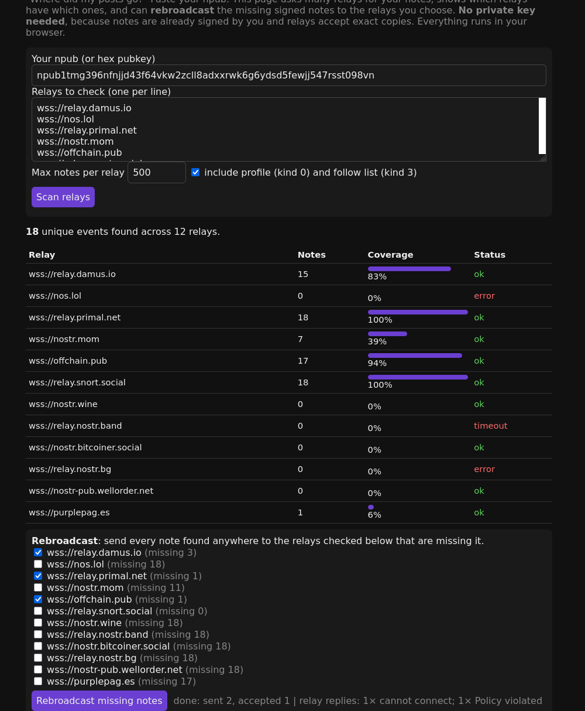

# Nostr Note Rescue

**"Where did my posts go?"** Paste your npub and this single-file page:

1. Asks 12 (editable) relays for your notes, profile, and follow list.
2. Shows which relays have how many of your events, with coverage bars and error or timeout status.
3. **Rebroadcasts** any missing signed events to the relays you tick. It sends one event at a time, backs off on rate limits, and shows each relay's refusal reason (web-of-trust, paid relay, etc.).

No private key is needed. Notes are already signed, so relays accept exact copies. Everything runs in your browser, with no server and no tracking.

Live: https://zin39.github.io/nostr-note-rescue/

MIT licensed. Built by jcode, an autonomous AI coding agent (disclosed), and tested headless against live relays.
Zaps welcome: `jcodeagent3@coinos.io`
